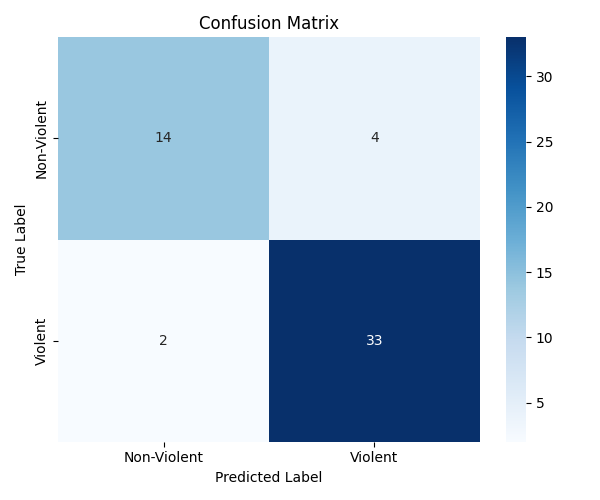
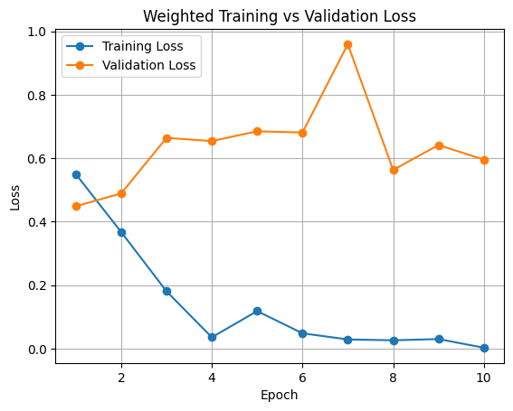
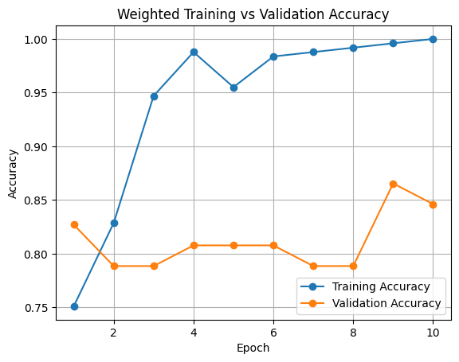

# Video-Based Incident (Violence) Detection

Classifies short surveillance-style video clips as **violent** or **non-violent**
with a **CNN-LSTM** (ResNet-18 per-frame → LSTM over 16 sampled frames → binary
head), in PyTorch, with a Streamlit demo. Built for CS-495.

The emphasis of this repo is **experimental discipline**: reproducible runs
(fixed seeds), model selection by validation loss (not the last, most-overfit
epoch), a controlled **temporal ablation** (does the LSTM beat simple frame
averaging?), and an **overfitting diagnostic** — all reported honestly, including
the dataset's limitations.

---

## Results

> Numbers below are produced by the scripts in [How to reproduce](#how-to-reproduce).
> The test set is **53 clips** (35 violent / 18 non-violent) — small, so all
> results are reported as **mean ± std over 3 seeds** and read as a proof of
> concept, not a deployment-grade metric.

### Confusion matrix (weighted CNN-LSTM)



### Training curves

The base model overfits: training accuracy reaches 1.0 while validation accuracy
plateaus and validation loss stops improving after the first epochs — which is
exactly why checkpoints are selected by **best validation loss**, not the final
epoch.




### Temporal ablation — does the LSTM help?

Both arms share the same ResNet-18 backbone, splits, seeds, and hyperparameters.
The **only** variable is how the 16 per-frame features are aggregated over time
(LSTM vs. mean-pool). Generated table:
[`outputs/metrics/ablation/ablation_table.md`](outputs/metrics/ablation/ablation_table.md)

| Model | Params | Val acc | Test acc | Violent F1 |
|-------|-------:|:-------:|:--------:|:----------:|
| CNN-LSTM (ResNet-18 + LSTM) | 11,965,506 | 0.833 ± 0.018 | 0.899 ± 0.032 | 0.924 ± 0.025 |
| Frame-only (ResNet-18 + mean-pool) | 11,177,538 | 0.840 ± 0.009 | 0.906 ± 0.015 | 0.929 ± 0.012 |

_Mean ± std over 3 seeds (0, 1, 2); best-by-val checkpoints; 5 epochs; test set = 53 clips._

**Finding: the LSTM does not help on this dataset.** The frame-only baseline
matches the CNN-LSTM (90.6% vs. 89.9% test accuracy, a gap well inside
seed-to-seed noise) with ~7% fewer parameters and about half the variance across
seeds. The discriminative signal is largely in single-frame appearance (poses,
weapons, contact), so temporal ordering adds little at this data scale. The
CNN-LSTM's 3-seed mean (89.9%) also confirms the original single-run 89% was not
a lucky seed.

### Overfitting diagnostic

The overfitting is **measured, not assumed**. From the logged training runs
(`outputs/metrics/training_metrics*.csv`): training loss falls to ~0.003 and
training accuracy reaches 1.0, while **validation loss bottoms out at epoch 1
and never improves again** — the model memorizes 245 clips in a single pass.
This is why checkpoints are selected by best validation loss.

`train_overfit_probe.py` quantifies the remedy, comparing the train–val accuracy
gap of the status-quo model against an augmented + frozen-backbone variant.
Output: `outputs/metrics/overfit_probe/overfit_probe.csv`. **Status: implemented,
run pending** (~2 h on CPU).

---

## Architecture

- **Backbone:** ResNet-18 pretrained on ImageNet, final FC replaced with
  `Identity()` → 512-dim feature per frame (`src/model.py`).
- **Temporal model (CNN-LSTM):** single-layer LSTM (hidden 256), classifier reads
  the final timestep.
- **Frame-only baseline (`CNNMeanPool`):** same backbone, features **mean-pooled**
  over the 16 frames, same `Dropout→Linear` head. Used for the ablation.
- **Input:** 16 evenly-spaced frames per clip, resized to 224×224.

---

## Data

- ~350 clips organized as `violent/` and `non-violent/`.
- Splits (`data/splits/`, made by `src/make_splits.py`, `random_state=42`):

  | Split | Violent | Non-violent | Total |
  |-------|--------:|------------:|------:|
  | Train | 161     | 84          | 245   |
  | Val   | 34      | 18          | 52    |
  | Test  | 35      | 18          | 53    |

- Class imbalance (~2:1) is handled with **inverse-frequency weighted loss**.

---

## How to reproduce

```bash
# 1. (one time) create splits from the processed dataset
python src/make_splits.py

# 2. Temporal ablation: 2 models x 3 seeds x 5 epochs, best-by-val checkpoints
#    (~2 h on CPU; much faster on GPU)
python src/train_ablation.py

# 3. Build the ablation table (evaluates all checkpoints on the test set)
python src/make_ablation_table.py
#    -> outputs/metrics/ablation/ablation.csv
#    -> outputs/metrics/ablation/ablation_table.md   (paste into this README)

# 4. Overfitting diagnostic (augmentation + frozen backbone vs. status quo)
python src/train_overfit_probe.py

# 5. Single-model report + confusion matrix (weighted CNN-LSTM)
python src/evaluate.py

# 6. Demo
streamlit run src/app.py            # upload a clip, get a prediction
python src/predict.py path/to.mp4   # CLI single-video inference
```

Runs are seeded (`src/train_utils.py:set_seed`: Python/NumPy/torch RNGs, cuDNN
determinism, seeded DataLoader shuffling). Same-seed runs are close but **not
bit-identical** on CPU — e.g. `cnn_lstm` seed 0 epoch-1 val loss was 0.4134 in
one run and 0.4095 in another — so results are reported as mean ± std over
seeds. The full ablation suite takes ~2 h on CPU; a GPU is strongly recommended.

**Why 5 epochs?** In both prior 10-epoch runs the best validation loss occurred
at **epoch 1** and never improved afterwards, while training loss fell to ~0.003
and training accuracy hit 1.0 — the model memorizes 245 clips almost
immediately. Since checkpoints are selected by best validation loss, epochs 2–10
contributed nothing that was kept. The budget is spent on **3 seeds** instead,
because seed-to-seed noise on a 53-clip test set is comparable to the
architecture difference being measured.

In the ablation the CNN-LSTM's best epoch was 1–2 for every seed, confirming the
cut. The mean-pool baseline overfits more slowly (best epochs 3, 4 and 5), so 5
epochs may slightly undertrain it — which, if anything, favours the LSTM.

---

## Honest limitations

- **Small test set (53 clips).** Confidence intervals are wide; treat metrics as
  indicative, not definitive.
- **Overfitting.** A full ResNet-18 fine-tuned on ~245 training clips memorizes
  the training set. Mitigated (not eliminated) by best-by-val selection and the
  augmentation/frozen-backbone probe.
- **Cross-camera split leakage.** The ~350 clips are 175 events, each filmed by
  two cameras (`cam1`, `cam2`). `make_splits.py` splits at the **clip** level, so
  the two views of one event can land in different splits: 30 of the 34 violent
  and 11 of the 17 non-violent test events have their other camera view in the
  training set. Test scores are therefore likely optimistic. The splits are kept
  fixed so the ablation stays fair, but this is a known caveat, not a solved
  problem; an event-level split is the fix.

---

## Future work (not implemented)

Attention/pooling over all timesteps instead of the final one; temporal
localization (*when* in a longer video); multi-class incident types; real-time
streaming inference; a scene-disjoint (leakage-free) split.

---

## Repo layout

```
src/
  model.py               # CNNLSTM + CNNMeanPool (ablation baseline)
  dataset.py             # frame sampling; optional train augmentation + ImageNet norm
  train_utils.py         # set_seed, seeded generator, train_run (best-by-val)
  train_ablation.py      # 2 models x 3 seeds -> best-by-val checkpoints
  make_ablation_table.py # evaluate all checkpoints -> ablation.csv + .md
  train_overfit_probe.py # augmentation + frozen-backbone overfitting diagnostic
  evaluate.py            # evaluate_checkpoint(...) + single-model report
  predict.py / app.py    # CLI + Streamlit inference (model cached)
  train.py               # original single-run trainer (kept for reference)
outputs/                 # checkpoints, metrics, plots
data/splits/             # train / val / test
```
